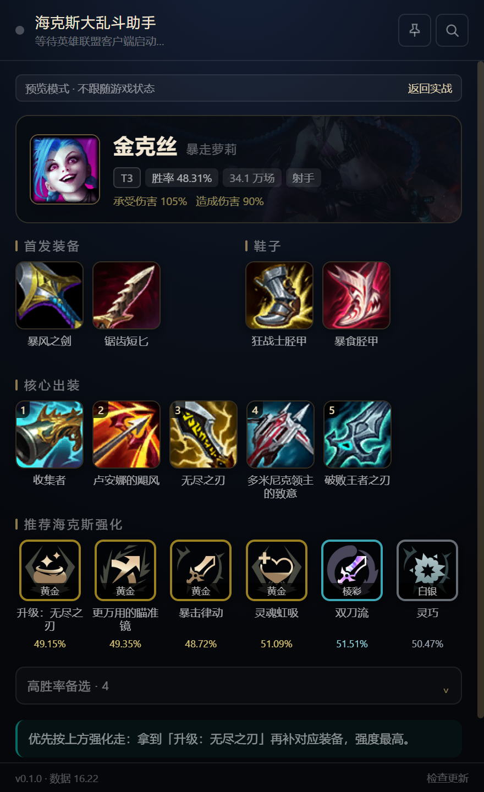
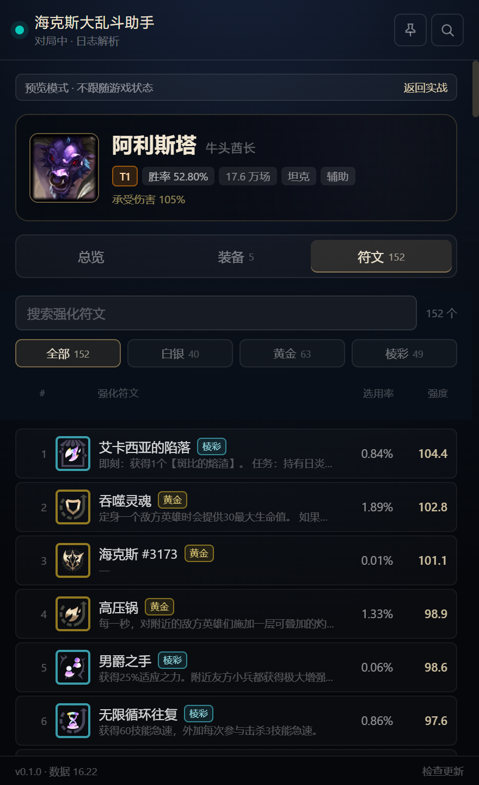
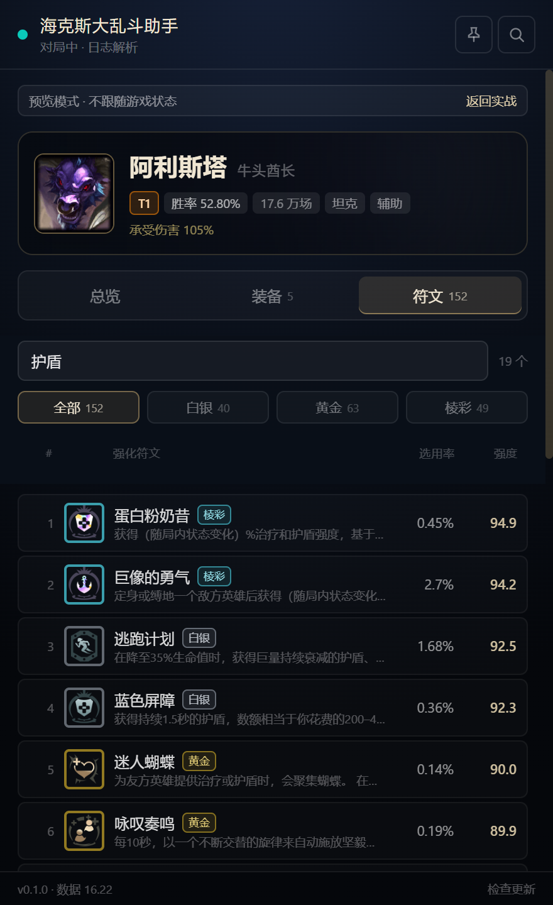
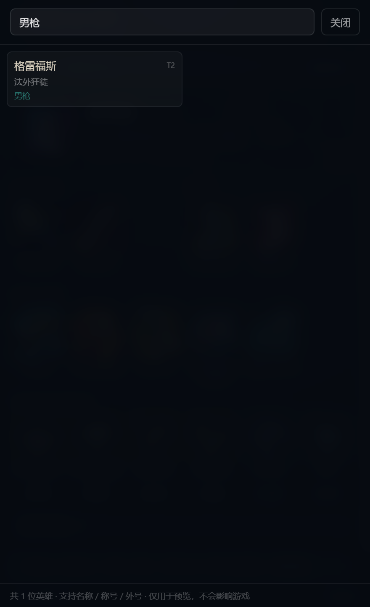

# 海克斯大乱斗出装助手

一个只读、轻量的 Windows 桌面小工具：在《英雄联盟》**海克斯大乱斗**（ARAM Mayhem，队列 2400）选人阶段，
自动识别你当前预选 / 锁定的英雄，展示该英雄在当前模式下的推荐出装与海克斯强化。

- 不读游戏内存、不注入 DLL，只通过官方客户端自带的 **LCU 本地 API** 读状态
- Tauri 2 + 系统 WebView2，可执行文件约 8.5 MB
- 数据来自 [resg.top](https://www.resg.top/)（英雄 / 装备 / 出装）与 [OP.GG](https://op.gg/zh-cn/lol/modes/aram-mayhem)（强化符文强度排序）；**装备、强化、英雄图标全部随包内置**，断网也能完整显示
- 英雄搜索支持 **名称 / 称号 / 外号**：搜「格雷福斯」「法外狂徒」「男枪」都能找到同一个英雄
- 自动更新：GitHub Releases + `latest.json`，应用内一键升级









## 它做什么

| 场景 | 表现 |
| --- | --- |
| 客户端未启动 | 顶栏灰点 + “等待英雄联盟客户端”，可手动浏览任意英雄出装 |
| 已连接、未进选人 | 显示当前阶段（房间中 / 匹配中 / 对局中） |
| 进入海克斯大乱斗选人 | 自动识别英雄（含自定义房间），三个页签：**总览 / 装备 / 符文** |
| 选人阶段强度榜 | 当前英雄 + 备战席英雄一起按 OP.GG 胜率排序，从左到右由强到弱，头像下显示全英雄排名 |
| 总览 | 核心五件套 + 首发/鞋子 + 推荐强化前 6 + 一句话建议 |
| 装备 | 核心出装、首发装备、鞋子、高胜率备选 |
| 符文 | 仿 OP.GG 榜单：全部强化一行一条，按 OP.GG 强度排序，可按品质筛选、可搜索 |
| 按 F1 | 全局热键：窗口没聚焦时呼出并置顶，聚焦时收起；对局中也能看到选人阶段识别的英雄 |
| 关闭窗口 | 不退出程序：收进桌面悬浮球，同时驻留任务栏右下角托盘 |
| 悬浮球 | 单击展开完整界面，按住可拖到桌面任意位置；托盘左键展开、右键退出 |
| 启动 / 选人 | 启动默认只显示悬浮球；进入海克斯或极地大乱斗选人阶段自动展开主界面 |
| 想先看看某个英雄 | 搜索框支持名称 / 称号 / 外号（「男枪」=「法外狂徒」=「格雷福斯」），点了就预览 |
| 换备战席英雄 | 500 ms 内跟随更新 |
| 其他模式（排位、普通等） | 明确提示不提供推荐，不误报 |
| 有新版本 | 顶部金色横幅 + 进度条，passive 静默安装后自动重启 |

> **F1 呼不出来？** 国服英雄联盟（WeGame / TenProtect）以管理员权限运行，助手必须同样以管理员运行，
> 否则 Windows 不允许低权限进程把窗口提到游戏前面——所以启动时会弹一次 UAC，点「是」即可。
> 另外「独占全屏」下任何浮窗都无法覆盖游戏，请在游戏设置里把显示模式改成「无边框」。

## 架构

```
React 19 + TS + Tailwind  ──invoke/event──  Rust (src-tauri)
         UI 渲染                              ├─ league-link：LCU 凭证发现 + HTTPS
                                              ├─ 500ms 轮询 gameflow-phase
                                              └─ 随包 JSON：resg.top 数据
```

- `src-tauri/src/lcu.rs`：凭证发现（进程扫描 → lockfile → 客户端日志三路兜底）、阶段轮询、选人会话解析
- `src-tauri/src/data.rs`：英雄 / 装备 / 强化符文与推荐出装的查询层（含名称、称号、外号合并）
- `src-tauri/data/*.json`：由 `scripts/gen-data.mjs` 生成、`include_str!` 打进二进制的静态数据
- `src-tauri/data/nicknames.json`：手工维护的英雄外号表，按 Data Dragon alias 索引
- `src/`：全部界面与交互逻辑

## 本地开发

前置（Windows 10/11 x64）：

- Node.js 20+
- Rust stable（`rustup`，MSVC 工具链）
- Visual Studio 2022 生成工具（C++ 桌面开发 + Windows SDK）
- WebView2 Runtime（Win11 自带，Win10 一般也已安装）

```powershell
npm install
npm run tauri dev     # 开发调试
npm run tauri build   # 产出安装包，见 src-tauri/target/release/bundle/nsis/
```

调试小技巧：地址后加 `#preview/222` 可以直接预览指定英雄（`222` = 金克丝），不用启动游戏。

## 数据说明

数据来源为 [resg.top](https://www.resg.top/) 的公开静态接口，`scripts/gen-data.mjs` 会抓取并生成两份文件：

- `src-tauri/data/resg.json`：英雄（含 Tier / 胜率）、装备、强化符文的元数据与图标地址
- `src-tauri/data/recommendations.json`：每个英雄的首发装备、鞋子、核心五件套、高胜率备选、推荐强化

用到的接口：

```
/api/v1/versions.js                          # 可用数据版本
/api/v1/versions/{v}/champions.js            # 全英雄概况
/api/v1/versions/{v}/champions/{id}.js       # 单英雄：分件出装统计、强化符文统计、承伤/输出修正
/api/v1/versions/{v}/augments.js             # 强化符文列表
/api/v1/versions/{v}/augments/{id}.js        # 强化符文详情（名称 / 描述）
/api/v1/items-detail.js                      # 装备名称与图标
```

抓取结果缓存在 `scripts/.cache/`，重复执行只补缺失项；游戏版本更新后执行：

```powershell
node scripts/gen-data.mjs              # 跟随数据站最新版本
node scripts/gen-data.mjs --version 16.22
node scripts/gen-data.mjs --refresh    # 忽略缓存重新抓
```

**字段含义**：

| 字段 | 来源 | 说明 |
| --- | --- | --- |
| `start` | resg `si` | 该英雄最常见的首发购买（通常是首件成装或关键小件） |
| `boots` | resg `b.BOOTS` | 出场率前二的鞋子 |
| `core` | resg `ia.combos["5"][0]` | 完整五件套中出场最多的一套，按购买顺序排列 |
| `situational` | resg `ia.items` | 场次 ≥ 1500 的装备里胜率最高的 4 件（排除已推荐） |
| `augments` | **OP.GG** | 该英雄的全部强化符文（按品质分档），每档内按 `performance` 强度分从高到低排序 |
| `tier` / `winRate` | resg 英雄概况 | 数据站给出的海克斯大乱斗强度分级与胜率 |

强化符文数据抓取自 `https://op.gg/zh-cn/lol/modes/aram-mayhem/{champion}/augments`，页面里内嵌了每个强化符文的
`performance`（强度分，100 ≈ 该模式平均水平）、`popular`（选用率）和 `rarity`（1 白银 / 4 黄金 / 8 棱彩）。
脚本保留该英雄所有有数据、有图标的强化（阿利斯塔约 152 个：白银 40 / 黄金 63 / 棱彩 49），以紧凑数组
`[id, performance, popular, quality]` 存储；OP.GG 抓取失败的英雄会退回 resg 的使用率前 6。

抓取是只读的、针对公开静态资源；如果数据站改版，脚本里集中改 `API` 前缀与字段解析即可。

脚本同时会把用到的图标下载到 `public/icons/`（装备 134 + 强化 243 + 英雄 173，共约 3.5 MB），
`resg.json` 里的 `icon` 字段直接写本地路径（如 `/icons/items/3031.png`），
所以运行时**不会发起任何图片请求**，断网、数据站挂掉都不影响展示。执行 `--refresh` 会重新下载。

### 英雄搜索与外号

搜索框同时匹配四类文本：

| 类型 | 示例 | 来源 |
| --- | --- | --- |
| 英雄名称 | 格雷福斯 | resg.top |
| 英雄称号 | 法外狂徒 | resg.top |
| 英文名 / alias | Graves | resg.top |
| 外号 | 男枪、石头人、快乐风男 | `src-tauri/data/nicknames.json` |

外号表是手工维护的（覆盖 170 位英雄），想补一个直接在对应 alias 的数组里加字符串即可，重启应用生效。
Rust 侧会过滤掉与英雄名完全相同的外号，避免搜索结果里出现重复文本。

## 发布与自动更新

1. 更新地址已经指向本仓库（`src-tauri/tauri.conf.json`），换仓库时只改这一行：

   ```json
   "endpoints": ["https://github.com/fusujifeng/Hextech-/releases/latest/download/latest.json"]
   ```

2. 仓库 Secrets 添加（Settings → Secrets and variables → Actions）：

   | Secret | 值 |
   | --- | --- |
   | `TAURI_SIGNING_PRIVATE_KEY` | `src-tauri/keys/updater.key` 的**完整内容** |
   | `TAURI_SIGNING_PRIVATE_KEY_PASSWORD` | `src-tauri/keys/password.txt` 里的密码 |

   公钥已经写在 `tauri.conf.json` 的 `plugins.updater.pubkey`，**私钥与密码绝不入库**
   （已在 `.gitignore` 中忽略 `src-tauri/keys/`）。

3. 打 tag 发布：

   ```powershell
   # 先把 src-tauri/tauri.conf.json 和 src-tauri/Cargo.toml 的 version 改成新版本号
   # latest.json 里的 version 取自 tauri.conf.json，不递增就不会提示更新
   git tag v0.1.0
   git push origin v0.1.0
   ```

`.github/workflows/release.yml` 会构建 NSIS 安装包、签名、生成 `latest.json` 并创建 Release。

每次打开软件，Rust 侧都会单开一条后台线程（`update-check`）静默请求上面的 `latest.json`：

- 有新版本 → 弹窗询问「立即更新 / 稍后再说」；确认后静默下载安装并自动重启
- 已是最新 / 还没发过 Release / 断网 → 静默跳过，不打断使用
- 底栏或「设置 → 软件更新」可随时主动检查一次更新

## 国服 / WeGame 说明

国服 WeGame 环境下，`LeagueClientUx.exe` 的**命令行是读不到的**（受保护进程），`lockfile` 也常常是 0 字节。
实测这台机器上：

- `英雄联盟\LeagueClient\lockfile` → 0 字节
- 进程命令行 / ExecutablePath → 空
- 但 `英雄联盟\LeagueClient\*_LeagueClientUx.log` 开头就写着完整参数：
  `--app-port=2951 --remoting-auth-token=...`

因此凭证发现按以下顺序进行：

1. 扫描 `LeagueClientUx.exe` 命令行里的 `--app-port` / `--remoting-auth-token`
2. 注册表卸载项（`DisplayName` 含「英雄联盟」/「League of Legends」）里的 `InstallLocation` / `InstallSource`
3. 常见安装根目录（`*:\WeGameApps`、`*:\Game\Wegame\WeGameApps` 等）扫一层
4. 依次尝试 `<install>\lockfile`、`<install>\LeagueClient\lockfile`
5. 依次尝试 `<install>\LeagueClient`、`<install>\Game\Logs\LeagueClient Logs` 等目录下最新的 `*_LeagueClientUx.log`

每个候选凭证都会先做一次 **TCP 端口存活检查**，避免上一次会话遗留的过期日志把应用卡在“连接失败”循环里。

另外，海克斯大乱斗的队列号有两套：

| 场景 | queue.id | queue.type / gameMode |
| --- | --- | --- |
| 匹配海克斯大乱斗 | 2400 | KIWI |
| **自定义海克斯大乱斗** | **3270** | KIWI（`isCustomGame: true`） |
| 自定义极地大乱斗 | 0 或 3270 | ARAM（靠 `mapId == 12` 兜底） |

所以模式判断依次看：`queue_id` → `gameMode/type == KIWI` → 名称含「海克斯」 → `queue_id == 450` / ARAM → 自定义且地图 12。

还有一个坑：LCU 只监听 `127.0.0.1`，如果机器上挂了系统代理，reqwest 会把本地请求也发给代理，表现是“端口通、客户端开着，但应用一直未连接”。
现在 LCU 客户端显式设置了 `.no_proxy()`，不再受代理环境影响。

## 已知限制

- 只在 Windows x64 上测试；其他平台未适配
- 英雄刚上线、数据站未收录时，会提示“暂无统计数据”
- 外号表为手工维护，冷门英雄的冷门叫法可能缺失
- 数据为统计结果，样本少的英雄（新英雄、冷门英雄）参考价值有限
- 队列号集中在 `src-tauri/src/lcu.rs` 的 `classify()`，模式标识变化时改一处即可

## 目录结构

```
├─ src/                     React 前端
│  ├─ components/           英雄卡、装备格、强化格、出装区、英雄选择器
│  └─ lib/                  invoke 封装、更新逻辑、类型
├─ public/icons/            随包图标（装备 / 强化 / 英雄，脚本生成）
├─ src-tauri/
│  ├─ src/lcu.rs            LCU 连接与轮询
│  ├─ src/data.rs           数据查询与命令
│  ├─ data/                 随包 JSON（脚本生成）+ 外号表
│  └─ tauri.conf.json       窗口 / 更新 / 打包配置
├─ scripts/gen-data.mjs     数据抓取脚本
├─ docs/                    截图
└─ .github/workflows/       打 tag 自动发布
```

## 给朋友的三步安装

1. 在 Releases 页面下载最新的 `ARAMHelper_x.y.z_x64-setup.exe`
2. 双击安装（Windows 可能提示未知发布者，选择“仍要运行”）
3. 启动英雄联盟并进入海克斯大乱斗选人，工具会自动显示推荐出装

---

本项目与 Riot Games 无关，数据仅供参考。
